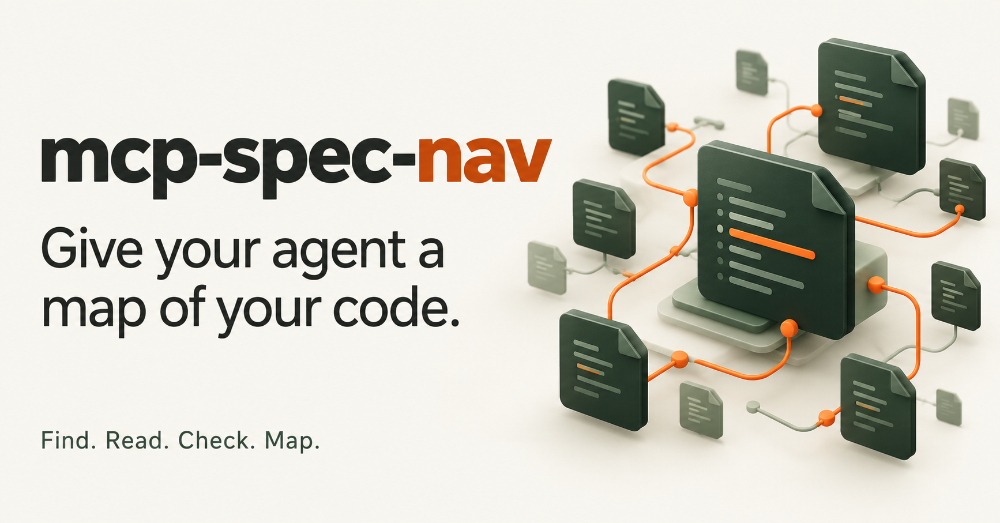

# mcp-spec-nav — MCP server tìm kiếm và điều hướng code cho AI

[English](README.md) · [Tiếng Việt](README.vi.md) · [简体中文](README.zh-CN.md)

[](https://khoitd-voyager.github.io/mcp-spec-nav/vi/)

`mcp-spec-nav` là MCP server chạy local cho coding agent như Claude Code. Nó đọc source code trong repo bạn chọn và giúp agent:

- **tìm hàm có sẵn** ở nhiều service và package dùng chung — theo từ khóa, theo các hàm nó gọi, hoặc theo hành vi giống một bản nháp;
- **đọc chính xác một hàm**: thân hàm, signature, tài liệu và các import nó dùng;
- **tìm nơi gọi hàm** trước khi sửa — kiểm tra bằng type checker cho TypeScript/JavaScript/Vue, theo bằng chứng cho Python, Go, Java, Kotlin, Swift và các ngôn ngữ khác; liệt kê riêng các lời gọi động;
- **tìm theo regex** trong các file nguồn được hỗ trợ, kèm tên hàm chứa mỗi kết quả;
- **lần theo luồng giữa các service** từ source code — HTTP client → route → handler, RPC → handler, event/topic → consumer — kèm bằng chứng cho từng link và phần chưa resolve được (phân tích tĩnh, [framework được hỗ trợ](docs/guide/flows.vi.md#framework-được-hỗ-trợ)).

**Vấn đề nó giải quyết:** trước khi viết logic mới hoặc sửa một hàm, agent cần biết repo đã có gì và cái gì phụ thuộc vào hàm đó. Chỉ dùng grep, agent có thể bỏ sót code đặt tên khác, viết lại logic đã có, hoặc sửa nhầm lời gọi trùng tên ở class khác.

MCP chỉ đọc code. Coding agent của bạn quyết định tái sử dụng gì, sửa file và chạy test. MCP không bảo đảm tìm được mọi hàm liên quan.

## Khi nào MCP hữu ích?

| Trường hợp | Giá trị của MCP |
|---|---|
| Logic nằm rải ở nhiều service | Cao: giúp tìm rộng, giảm bỏ sót. |
| Muốn tái sử dụng hàm thay vì viết lại | Cao, nếu truy vấn tìm đúng ứng viên. |
| Sửa tham số hàm, cần tìm callers | Hữu ích. |
| Lần theo một request hoặc event từ service này sang service khác | Hữu ích với các framework được hỗ trợ: link tĩnh kèm bằng chứng; phần không xác định được thì báo rõ, không đoán. |
| Sửa đơn giản trong một file | Lợi ích ít, có thể thêm lượt gọi tool. |

Mỗi lượt model khi đã cài MCP còn mang theo định nghĩa tool (~3,8k token trong benchmark), nên với thay đổi nhỏ, một khái niệm, lợi ích ít.

## Ví dụ: sửa phí đơn hàng

[docs/examples/order-fee](docs/examples/order-fee/) là ví dụ 4 file chạy được. Yêu cầu: tăng phí xử lý từ 5 lên 7 và cho mọi nơi gọi được miễn phí. Kết quả bên dưới là output thật khi chạy tool trên [`before/`](docs/examples/order-fee/before/), đã rút gọn.

**1. Tìm logic có sẵn** — MCP, `spec_nav_find_functions` với `{ "query": "order handling fee total" }`:

```text
#1  score 3.05  billing/fees.ts:35-43  (service ., typescript)
    [function, exported] calculateTotal
    why: handling→body  fee→path(stem:fees)  total→name
```

**2. Đọc implementation** — MCP, `spec_nav_read_function` với `{ "file": "billing/fees.ts", "name": "calculateTotal" }`:

```text
35| export function calculateTotal(subtotal) {
39|   const handlingFee = HANDLING_FEE;
42|   return subtotal + handlingFee;
43| }
```

**3. Tìm mọi nơi gọi** — MCP, `spec_nav_callers` với `{ "symbol": "calculateTotal", "file": "billing/fees.ts" }`:

```text
"total": 3, "exhaustive": true,
"targets": [{ "file": "billing/fees.ts", "line": 35, "resolvedBy": "type checker" }],
"sites": [
  { "file": "billing/previewInvoice.ts", "line": 3, "enclosing": "previewInvoice", "resolution": "resolved" },
  { "file": "checkout/createOrder.ts", "line": 3, "enclosing": "createOrder", "resolution": "resolved" },
  { "file": "orders/updateOrder.ts", "line": 3, "enclosing": "updateOrder", "resolution": "resolved" }
```

**4. Lần theo qua các service** — MCP. `spec_nav_callers` chỉ đếm lời gọi trực tiếp và ghi rõ điều đó: lời gọi qua HTTP/RPC/queue không được tính. Trong ví dụ nhiều service [docs/examples/order-flow](docs/examples/order-flow/), `spec_nav_trace_flow` với `{ "file": "services/checkout/src/handlers/createOrder.ts", "name": "createOrderHandler", "direction": "both" }` cho thấy ai gọi tới handler và tổng tiền đi tiếp tới đâu:

```text
steps: 5 (5 resolved) — this page 1-5 — COMPLETE
gaps: none found among the supported adapters.
#1  d1 ↑ HTTP  POST http://checkout:3000/api/orders → POST /api/orders   [resolved · high]
    from  services/storefront/src/checkout-client.ts:3  submitOrder
#2  d1 ↓ call  createOrderHandler → calculateTotal   [resolved · high]
#4  d2 ↓ EVENT event order.created → event order.created (kafka)   [resolved · medium]
    to    services/invoicing/src/consumer.ts:12  handleOrderCreated
```

**5. Sửa code** — coding agent: đặt `HANDLING_FEE` thành 7, thêm tham số `options` cho `calculateTotal` và truyền `waiveHandlingFee` từ 3 nơi gọi. Kết quả ở [`after/`](docs/examples/order-fee/after/).

**6. Chạy test** — coding agent:

```bash
node --test docs/examples/order-fee/verify.mjs   # 6 test pass
```

## Cài nhanh (Claude Code)

**Cần có:** Node.js 18+, npm/npx, Git và repo cần quét đã nằm trên máy. Lần cài đầu cần kết nối mạng.

**1.** Tạo `.mcp.json` ở thư mục gốc của repo cần quét. Nếu đã có, thêm `spec-nav` vào `mcpServers` hiện có và giữ các MCP khác.

```json
{
  "mcpServers": {
    "spec-nav": {
      "command": "npx",
      "args": ["-y", "github:khoitd-voyager/mcp-spec-nav"],
      "env": {
        "SPEC_NAV_ROOT": "/Users/you/code/your-repo"
      }
    }
  }
}
```

Thay `/Users/you/code/your-repo` bằng **đường dẫn tuyệt đối tới code cần quét** (trỏ tới gốc monorepo để quét mọi service) — không phải thư mục cài `mcp-spec-nav`.

**2.** Mở Claude Code trong repo đó, khởi động lại session, chạy `/mcp` và kiểm tra `spec-nav` đã kết nối. Nếu client yêu cầu duyệt cấu hình, hoàn tất bước đó.

**3.** Gửi Claude:

```text
Dùng spec-nav liệt kê các service trong repo này.
Cho tôi biết đường dẫn repo đang quét và những phần chưa quét được.
```

Kiểm tra đường dẫn và danh sách service đúng với dự án trước khi dùng tiếp.

**4.** Thử một task thật:

```text
Tôi muốn thêm tham số vào calculateFee. Dùng spec-nav tìm declaration,
đọc implementation và kiểm tra các nơi gọi hàm trước khi lên kế hoạch sửa.
Báo rõ những lời gọi chưa resolve được.
```

Cài MCP chỉ làm cho tool có sẵn, không bảo đảm agent sẽ dùng. Thêm [đoạn hướng dẫn vào `CLAUDE.md`](docs/guide/installation.vi.md#hướng-dẫn-claude-dùng-khi-code-bình-thường) để Claude dùng khi code bình thường. Thêm câu mẫu, extension cho Claude Desktop (không cần Node.js) và cài từ source local: [Cài đặt](docs/guide/installation.vi.md).

## Các tool

| Tool | Mục đích |
|---|---|
| `spec_nav_services` | Kiểm tra đường dẫn quét, các project, số lượng file/hàm và coverage. |
| `spec_nav_find_functions` | Tìm các hàm có thể đáp ứng yêu cầu, xếp hạng và giải thích vì sao khớp. |
| `spec_nav_similar_functions` | Tìm hàm có hành vi giống một hàm hoặc một bản nháp, dù tên khác hẳn. |
| `spec_nav_read_function` | Đọc code chính xác của một hàm, kèm signature, tài liệu và import liên quan. |
| `spec_nav_functions` | Xem danh mục hàm, lọc và lấy từng trang. |
| `spec_nav_callers` | Kiểm tra lời gọi, references, lời gọi động và những trường hợp chưa resolve được. |
| `spec_nav_map` | Tìm dòng khớp regex, kèm tên hàm chứa dòng đó. |
| `spec_nav_trace_flow` | Lần theo link HTTP, RPC và event giữa các service, theo chiều upstream hoặc downstream, kèm bằng chứng và phần chưa resolve. |

Tham số, ví dụ JSON, phân trang, coverage và trạng thái kết quả: [Tham khảo tool](docs/guide/tools.vi.md).

## Ngôn ngữ hỗ trợ

TypeScript, JavaScript, Python, Go, Java, C#, Ruby, Rust, PHP, C, C++, Scala, Elixir, Bash, Kotlin, Swift và component Vue/Svelte/Astro (khối script). Callers được **kiểm tra bằng type checker cho TS/JS/Vue/Svelte/Astro** và **theo bằng chứng cho mọi ngôn ngữ còn lại**. Luồng giữa các service chỉ được lần theo cho framework TypeScript/JavaScript và Python. Đuôi file và cách parse: [Ngôn ngữ hỗ trợ](docs/guide/languages.vi.md).

## Benchmark

**Chưa có benchmark nào chạy bằng LLM thật.** Mọi kết quả bên dưới đến từ **agent mô phỏng**: chính sách tất định, không phải LLM, để khác biệt đo được là do công cụ. Một agent chỉ có Grep/Read/Edit (như tool built-in của Claude Code), agent kia có spec-nav cùng Read/Edit. Phía không-MCP được cho sẵn kiến thức đồng nghĩa như LLM và cùng luật chấm hào phóng. Mỗi session là một feature request trọn vẹn: tái sử dụng logic có sẵn, đổi signature một hàm và sửa mọi caller, đổi một hằng số ở mọi nơi, rồi đọc và sửa từng file. Repo: một monorepo giả lập có seed (đáp án do generator cài) và immich@cc7fd67 (đáp án từ `findReferences` của TypeScript, doc comment và ripgrep). Token ước lượng 3,5 ký tự/token.

| | Giả lập, 100 session | Giả lập, 50 session lớn | immich (thật), 20 session | immich (thật), 10 session lớn |
|---|---:|---:|---:|---:|
| Context mỗi session, không MCP → MCP | 31k → 24k (−25%) | 92k → 71k (−24%) | 116k → 98k (−16%) | 302k → 227k (−25%) |
| …trong đó pha tìm kiếm | −57% | −55% | −70% | −69% |
| Input token có prompt caching | −18% | −26% | −16% | −38% |
| Số tool call (lượt model) | −10% | −9% | −2% | −20% |
| Tái sử dụng được hàm có sẵn | 97% → 99% | 90% → 95% | 55% → 90% | 40% → 93% |
| Callers đủ, không thừa | 100% → 100% | 100% → 100% | 85% → 90% | 53% → 73% |
| Sửa nhầm mỗi session | 0 → 0 | 0 → 0 | 0.3 → 0.2 | 14.4 → 2.4 |
| Session đúng hoàn toàn | 97% → 99% | 70% → 86% | 50% → 85% | 0% → 30% |
| Thời gian tool, gồm cold start MCP | +4.1 s | +6.1 s | +3.2 s | +6.6 s |

Phần đọc file để sửa tốn như nhau; khoản tiết kiệm nằm ở pha tìm kiếm. Chất lượng tăng nhờ tìm được code dù tên khác (reuse) và không sửa nhầm lời gọi trùng tên ở class khác (callers).

**Repo rất lớn** — VS Code (14.306 file, ~4,5 triệu dòng, 154k hàm trong danh mục), Apple M4: index lần đầu 31 s, sau đó `find_functions` 2,6–4,3 s, `map` 0,5–1,8 s, `similar_functions` 0,9 s, `read_function` 0,15 s; `callers` 16 s với hàm thường, 90 s và 3 GB RAM với tên xuất hiện trong 822 file (`readFile`). Bộ nhớ server 0,7–0,9 GB ngoài `callers`.

**Luồng giữa các service** (không có agent, không có LLM) — `spec_nav_trace_flow` trên repo sinh tự động (14 service mỗi repo, 5 seed kiểm tra, 598 điểm gọi có đáp án): precision 100%, 0 link nối sai (nối chỉ theo tên: 136 link sai), recall 84% — mọi trường hợp bỏ sót là lời gọi qua hàm wrapper hoặc `urljoin`, adapter không lần theo. Lần gọi đầu ~0,1 s (0,7 s với repo 1.000 file), sau đó 1–10 ms mỗi lần. Bộ sinh và adapter cùng tác giả, nên đây là phép kiểm tra luật nối, không phải độ phủ trên code thật.

Phương pháp, giả định và giới hạn: [bench/README.md](bench/README.md#tiếng-việt). Báo cáo: [giả lập](bench/results/synthetic-150-sessions.md#tiếng-việt) · [immich](bench/results/real-immich-30-sessions.md#tiếng-việt) · [thời gian trên VS Code](bench/results/perf-vscode.md) · [luồng](bench/results/flow-test.md#tiếng-việt) · [tất cả kết quả](bench/results/).

## Giới hạn

- **Tìm kiếm theo từ vựng.** Tìm theo từ, tên hàm được gọi, viết tắt, đồng nghĩa, khái niệm, IDF. `spec_nav_similar_functions` tìm được code cùng hành vi khác tên khi chúng có chung lời gọi/từ vựng; hai cách viết không chung gì thì vẫn sót. Kết quả là ứng viên, không chứng minh repo không còn implementation khác.
- **Dịch.** Tiếng Việt có dấu được dịch qua từ điển ~100 thuật ngữ phổ biến; từ ngoài từ điển không được dịch. Dùng từ khóa tiếng Anh nếu code đặt tên bằng tiếng Anh.
- **Tái sử dụng.** Cần tự kiểm tra export, hành vi và dependency giữa package/service.
- **Callers.** Ngoài TS/JS, gắn lời gọi theo bằng chứng (import, qualifier, kiểu receiver được khai báo), không có type checker: kiểu suy luận, kế thừa, overload có thể để lại `likely`/`ambiguous`. Tên ghép lúc chạy, gọi qua HTTP/RPC/queue và repo ngoài không được `spec_nav_callers` lần theo (HTTP/RPC/event giữa các service: xem `spec_nav_trace_flow`).
- **Luồng.** Phân tích tĩnh từ source: link được suy ra, không quan sát lúc chạy, và chỉ với [framework được hỗ trợ](docs/guide/flows.vi.md#framework-được-hỗ-trợ). Chưa hỗ trợ: gRPC, GraphQL, WebSocket, queue khác (BullMQ, RabbitMQ, SQS…), Go, Java và ngôn ngữ khác, API client sinh tự động, URL dựng trong hàm wrapper hoặc bằng `urljoin`, service discovery và cấu hình ngoài docker-compose, cùng một số trường hợp khác — xem [Chưa được lần theo](docs/guide/flows.vi.md#chưa-được-lần-theo).
- **Dạng hàm.** Callback anonymous inline không có mục riêng (coverage đếm chúng trong JS/TS). Chưa bao phủ đầy đủ assignment qua destructuring/property động, hàm từ factory, `Object.assign`/`Object.defineProperty` và một số gán nối trong JS/TS. Lambda/closure gán biến ở ngôn ngữ khác chưa có trong danh mục.
- **File.** Không parse Dart, Lua, Objective-C, SQL và các loại nguồn chưa hỗ trợ (có đếm trong coverage). Bỏ qua thư mục dependency/build, thư mục ẩn, virtualenv, file declaration, JS minified và file hỗ trợ lớn hơn 1,5 MB.
- **Kiểu.** Danh mục lấy kiểu trả về được khai báo, không suy luận kiểu.
- **Repo lớn.** Đo trên VS Code (14k file): index lần đầu ~31 s, tìm kiếm vài giây. Callers TS/JS chỉ type-check file nhắc tới tên, theo lô, lần import 2 bước; tên rất phổ biến tốn vài phút và ~3 GB, lời gọi có kiểu receiver nằm xa hơn được báo `unresolved`.
- **Dependency.** Resolve kiểu TS/JS tốt nhất khi đã cài dependency (`node_modules`); thiếu thì kiểu thư viện không có và nhiều lời gọi thành `unresolved`.

Server đọc checkout local hiện tại. Không cần API key tìm kiếm và phần tìm kiếm không gửi code tới dịch vụ search bên ngoài. Kết quả được trả cho coding agent đã kết nối; cách client/model xử lý dữ liệu vẫn theo cấu hình của bạn.

## Tài liệu

- [Cài đặt](docs/guide/installation.vi.md) — Claude Code, extension cho Claude Desktop, đoạn `CLAUDE.md`, cài từ source local
- [Tham khảo tool](docs/guide/tools.vi.md) — tham số, ví dụ JSON, cách đọc kết quả
- [Lần theo luồng giữa các service](docs/guide/flows.vi.md) — framework, trạng thái link, confidence, gaps
- [Ngôn ngữ hỗ trợ](docs/guide/languages.vi.md)
- [Khi gặp lỗi](docs/guide/troubleshooting.vi.md)
- [Phát triển](docs/guide/development.vi.md) — test, đóng gói extension, benchmark, website
- [Phương pháp benchmark](bench/README.md#tiếng-việt) · [Website](https://khoitd-voyager.github.io/mcp-spec-nav/vi/)

## Giấy phép

MIT. Xem [LICENSE](LICENSE).
